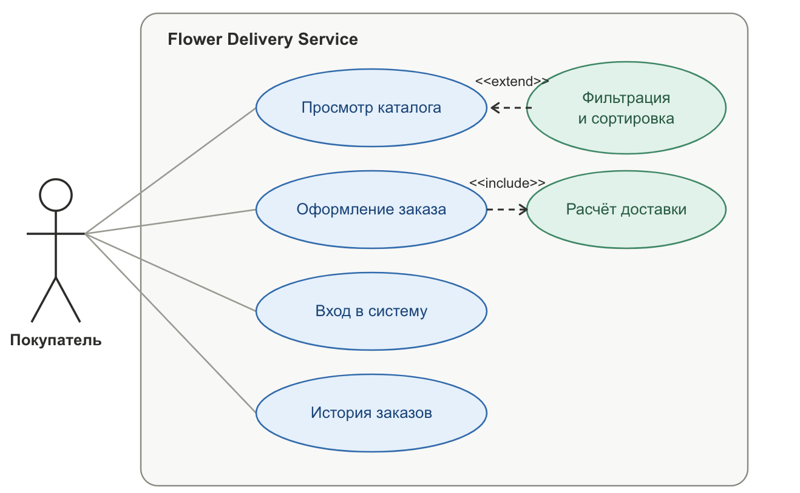
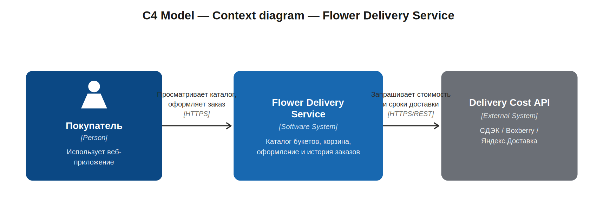
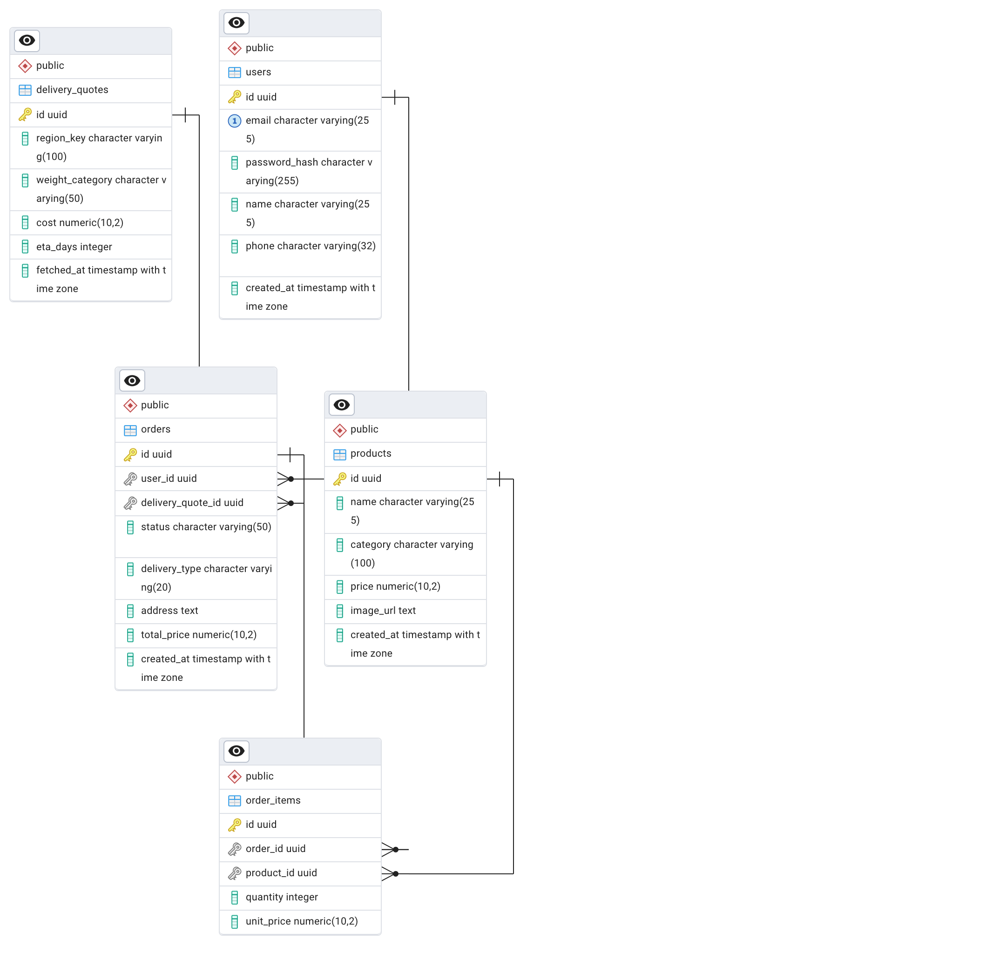
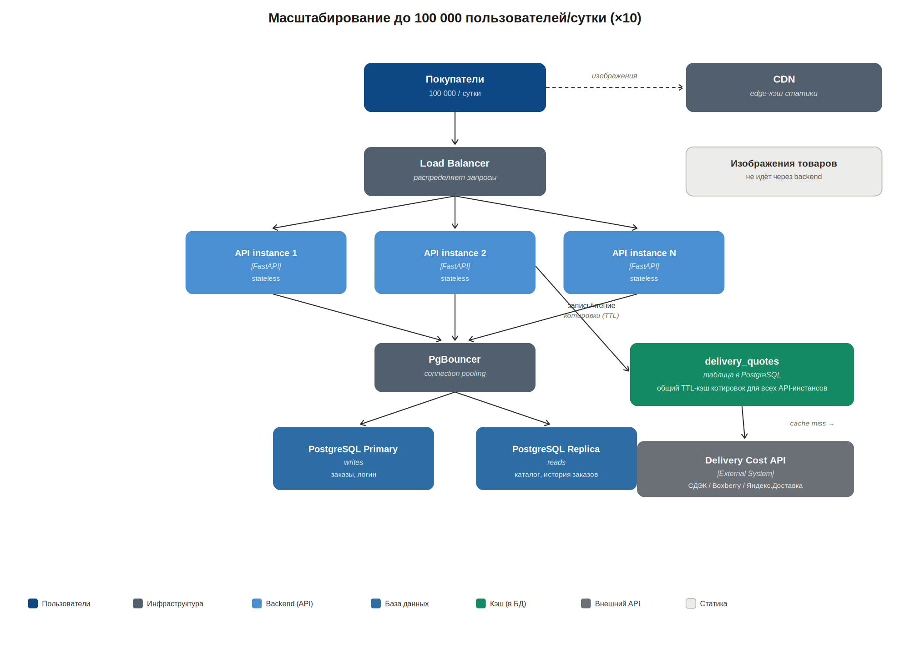

# Flower Delivery Service

Онлайн-сервис доставки цветов с расчётом стоимости и сроков доставки по адресу в реальном времени.

## Команда

| ФИО | Группа | Роль |
|---|---|---|
| Бокова Дарья Александровна | 5130904/400107 | Backend, инфраструктура, архитектура |
| Астафьева Дарья Юрьевна | 5130904/40107 | Frontend, UI/UX |

## Проблема

Покупателям неудобно заказывать цветы вручную через соцсети или по телефону — нет единого каталога, а стоимость и сроки доставки становятся известны только после согласования с флористом. Сервис даёт витрину букетов с фильтрацией и мгновенным расчётом доставки на этапе оформления заказа.

## Тема проекта

Онлайн-сервис доставки цветов с интеграцией внешнего API расчёта стоимости и сроков доставки.

## Стек технологий

- **Backend:** Python (FastAPI)
- **База данных:** PostgreSQL
- **Frontend:** React
- **Внешняя зависимость:** API расчёта стоимости и сроков доставки (СДЭК / Boxberry / Яндекс.Доставка)
- **Контейнеризация:** Docker, Docker Compose
- **CI:** GitHub Actions

---

## Этап 2. Требования

### User Stories

1. **Как покупатель**, я хочу отфильтровать букеты по цене и поводу (день рождения, романтика, соболезнования), чтобы быстро найти подходящий вариант, не пролистывая весь каталог.
   *Критерий готовности:* при выборе фильтра список обновляется без перезагрузки страницы; при отсутствии совпадений показывается сообщение «товары не найдены».

2. **Как покупатель**, я хочу увидеть точную стоимость и срок доставки по моему адресу ещё до оплаты, чтобы не тратить время на заказ, который окажется слишком дорогим или долгим.
   *Критерий готовности:* при вводе адреса в форме заказа расчёт доставки подтягивается автоматически за разумное время (см. таблицу [Read/Write профиль (в сутки)](#readwrite-профиль-в-сутки) ниже); если внешний сервис недоступен — пользователь видит приблизительную оценку, а не ошибку.

3. **Как покупатель**, я хочу видеть историю своих заказов с датой, составом и суммой, чтобы отслеживать, что и когда я покупал.
   *Критерий готовности:* список заказов доступен из личного кабинета, отсортирован от новых к старым.

4. **Как покупатель**, я хочу получить подтверждение, что заказ принят, даже если сервис расчёта доставки в этот момент недоступен, чтобы не потерять заказ из-за сбоя стороннего API.
   *Критерий готовности:* заказ создаётся и сохраняется в БД независимо от статуса внешнего API; точная стоимость доставки может быть уточнена постфактум.

5. **Как покупатель**, я хочу отсортировать букеты по цене или популярности, чтобы сравнить варианты в своём бюджете.
   *Критерий готовности:* доступна сортировка по возрастанию/убыванию цены и по количеству заказов.

*UML-диаграмма прецедентов — визуальное представление тех же сценариев: Покупатель напрямую инициирует четыре основных прецедента, «Фильтрация и сортировка» расширяет (`<<extend>>`) просмотр каталога, «Расчёт доставки» включён (`<<include>>`) в оформление заказа.*

### Масштаб системы — оценка нагрузки

Базовая оценка: **10 000 уникальных пользователей в сутки**.

**Профиль поведения пользователя за сессию (допущение):**
- 3 запроса `GET /goods` (первая загрузка каталога + смена фильтров/сортировки)
- 5 открытий карточки товара (модалка)
- 10% пользователей доходят до чекаута → запрос расчёта доставки (`GET /delivery/quote`)
- 5% пользователей завершают заказ → `POST /orders`
- 50% сессий — залогиненные пользователи → `POST /login`

### Read/Write профиль (в сутки):

| Операция | Тип | Запросов/сутки |
|---|---|---|
| `GET /goods` (каталог) | read | ~30 000 |
| `GET /goods/{id}` (карточка) | read | ~50 000 |
| `GET /delivery/quote` | read (внешняя зависимость) | ~1 000 |
| `POST /login` | write | ~5 000 |
| `POST /orders` | write | ~500 |

Итого: **~81 000 read** против **~5 500 write** — соотношение примерно **15:1** в пользу чтения. Это обосновывает кэширование каталога и котировок доставки как приоритетную оптимизацию (in-memory кэш на уровне backend-процесса — см. раздел [Отказоустойчивость](#отказоустойчивость-fault-tolerance)), а не масштабирование записи.

**Сетевой трафик:**
Каталожные и карточные ответы (JSON, без учёта изображений — они отдаются отдельно, статикой/CDN) — в среднем ~70–100 КБ на ответ. При ~80 000 read-запросов в сутки это даёт ориентировочно **6–8 ГБ/сутки** (~180–240 ГБ/месяц) backend-трафика. Write-запросы (логин, заказ) — единицы КБ каждый, вклад в общий трафик пренебрежимо мал.

**Объём хранения за 5 лет:**

| Таблица | Строк за 5 лет | Оценка объёма |
|---|---|---|
| orders | ~915 000 (500/день × 365 × 5) | ~450 МБ |
| order_items | ~2,3 млн (в среднем 2.5 позиции на заказ) | ~460 МБ |
| users | ~150 000 уникальных регистраций | ~50 МБ |
| products | сотни SKU | <10 МБ |
| delivery_quotes (кэш котировок) | ~1,46 млн | ~440 МБ |

Итого структурированных данных за 5 лет: **~1,4–1,5 ГБ**, с учётом индексов (+30–50%) — порядка **2–2,5 ГБ**. Это принципиально не требует шардирования или партиционирования на горизонте 5 лет при нагрузке 10 000 польз./сутки — задача решается одним инстансом PostgreSQL с обычными индексами.

### Отказоустойчивость (Fault Tolerance)

**Внешняя зависимость:** API расчёта стоимости и сроков доставки (СДЭК / Boxberry / Яндекс.Доставка).

Поведение при недоступности API:

1. **Таймаут.** На каждый запрос к внешнему API устанавливается жёсткий таймаут (например, 3 секунды) — чтобы недоступность стороннего сервиса не блокировала оформление заказа у пользователя.

2. **Circuit Breaker.** Отслеживается доля неудачных запросов за скользящее окно (например, за последнюю минуту). При превышении порога (например, ≥50% ошибок или 5 подряд неудачных попыток) цепь переходит в состояние **Open**: дальнейшие запросы к API не отправляются вообще в течение cooldown-периода (например, 30 секунд), сразу используется fallback. По истечении cooldown цепь переходит в **Half-Open** — пропускается один пробный запрос; при успехе цепь закрывается (**Closed**, обычный режим), при неудаче — снова **Open**.

3. **Кэширование.** Успешные котировки доставки кэшируются по ключу (город/регион + весовая категория) с TTL (например, 6 часов) **в памяти backend-процесса** (например, через `cachetools` в Python — без отдельного внешнего кэш-сервиса) и одновременно сохраняются в таблицу `delivery_quotes` в PostgreSQL (см. ER-диаграмму ниже) — это тот же самый механизм, который на Этапе 3 становится основой для распределённого кэша при масштабировании. При недоступности API и открытой цепи сервис в первую очередь отдаёт последнюю известную котировку из кэша для этого региона, помечая её в интерфейсе как приблизительную.

4. **Деградация.** Если для региона нет ни живого ответа API, ни кэша — используется фиксированный тарифный справочник (плоская ставка по зонам доставки), также с пометкой «предварительная стоимость, будет уточнена».

5. **Заказ не блокируется.** Оформление заказа (`POST /orders`) не зависит от успешности расчёта доставки — заказ создаётся и сохраняется в любом случае. Точная стоимость доставки может быть пересчитана асинхронно фоновой задачей после восстановления API, с уведомлением пользователя при существенном расхождении.

---

## Этап 3. Архитектура и детальное проектирование

### Анализ нагрузок (Capacity Planning)

Расчёт соотношения Read/Write, сетевого трафика и объёма хранения за 5 лет уже выполнен на Этапе 2 (см. раздел «Масштаб системы — оценка нагрузки» выше) — на Этапе 3 эти цифры используются как вход для архитектурных решений ниже (выбор точек кэширования, индексов и стратегии масштабирования).

### C4 Model — Context diagram

### C4 Model — Conteiner diagram

### Контракты API

| Метод | Путь | Назначение | Целевая latency (p95) |
|---|---|---|---|
| `POST` | `/login` | Аутентификация пользователя | < 400 мс |
| `POST` | `/logout` | Завершение сессии | < 150 мс |
| `GET` | `/goods` | Список товаров (с фильтрами и сортировкой) | < 300 мс |
| `GET` | `/goods/{id}` | Детальная карточка товара | < 200 мс |
| `GET` | `/delivery/quote` | Расчёт стоимости/срока доставки по адресу | < 1000 мс при попадании в кэш; до 3000 мс при обращении к внешнему API (жёсткий таймаут, далее — fallback) |
| `POST` | `/orders` | Создание заказа | < 500 мс (не блокируется ответом от `/delivery/quote`) |
| `GET` | `/orders` | История заказов пользователя | < 300 мс |

Нефункциональное требование: ни один эндпоинт, кроме `/delivery/quote`, не должен иметь в цепочке вызовов синхронную зависимость от внешнего API — это прямое следствие раздела «Отказоустойчивость» (Этап 2).

### Проектирование данных (ER-диаграмма)

**Обоснование индексов под расчётную нагрузку (Этап 2):**

- `PRODUCTS (category, price)` — составной индекс. `GET /goods` с фильтром по категории/цене — самый частый запрос системы (~30 000/сутки), без индекса каждый такой запрос уходил бы в full scan таблицы товаров.
- `ORDERS (user_id, created_at DESC)` — обслуживает `GET /orders` (история заказов пользователя): выборка «последние заказы этого пользователя» без индекса требовала бы сортировки всей таблицы заказов (до ~915 000 строк за 5 лет).
- `ORDER_ITEMS (order_id)` — обязателен для JOIN при сборке состава заказа (используется в каждом вызове `GET /orders` и при оформлении заказа).
- `DELIVERY_QUOTES (region_key, weight_category, fetched_at DESC)` — ключевой индекс для быстрого поиска «последней живой котировки для региона» при недоступности внешнего API (раздел «Отказоустойчивость»); без индекса деградация при сбое внешнего API сама стала бы узким местом.
- `USERS (email)` — уникальный индекс, обслуживает `POST /login` (~5 000/сутки).

При соотношении Read/Write ~15:1 (Этап 2) эти индексы напрямую ускоряют именно read-нагрузку, которая доминирует; накладные расходы на индексацию при записи (~5 500 write/сутки) остаются пренебрежимо малы для одного инстанса PostgreSQL.

### Масштабирование до 100 000 пользователей/сутки (×10)

**Стратегия при росте нагрузки в 10 раз:**

1. **Горизонтальное масштабирование backend.** API stateless (сессии — через JWT, без серверного состояния), поэтому можно просто запустить несколько инстансов FastAPI за Load Balancer без изменений в логике.

2. **Read-реплики PostgreSQL.** При read-нагрузке ~810 000 запросов/сутки (10× от Этапа 2) каталожные и read-эндпоинты (`GET /goods`, `GET /orders`) направляются на реплику, запись (`POST /orders`, `POST /login`) — на primary. Это напрямую следует из ранее рассчитанного соотношения Read/Write ~15:1 — узкое место при росте именно в чтении.

3. **Кэширование внешних запросов без блокировок API.** Ключевое требование Этапа 3: механизм кэширования, чтобы 10-кратный рост не привёл к троттлингу со стороны Delivery Cost API. Поскольку backend теперь работает в нескольких инстансах, in-memory кэш одного процесса (Этап 2) перестаёт быть общим — вместо него общим кэшем становится уже спроектированная таблица `delivery_quotes` в PostgreSQL: она физически одна на все API-инстансы, поэтому Circuit Breaker и TTL-кэш котировок работают согласованно для всех запросов, а число реальных обращений к внешнему API не растёт пропорционально числу инстансов backend. Отдельный кэш-сервис (Redis и т.п.) не требуется — используется уже существующая в схеме БД таблица.

4. **PgBouncer (connection pooling).** С ростом числа API-инстансов растёт число открытых соединений к PostgreSQL — пул соединений снимает эту нагрузку с БД.

5. **CDN для статики.** Изображения товаров выносятся из зоны ответственности backend полностью — при 10× росте это исключает рост backend-трафика (Этап 2: ~6–8 ГБ/сутки) из-за изображений.

6. **Партиционирование — задел на будущее.** При объёме хранения за 5 лет ~2–2,5 ГБ (Этап 2) партиционирование `orders`/`delivery_quotes` по дате пока не требуется даже при 10× росте (~15–25 ГБ за 5 лет) — но остаётся понятной точкой расширения, если горизонт хранения увеличится сверх 5 лет.

---

